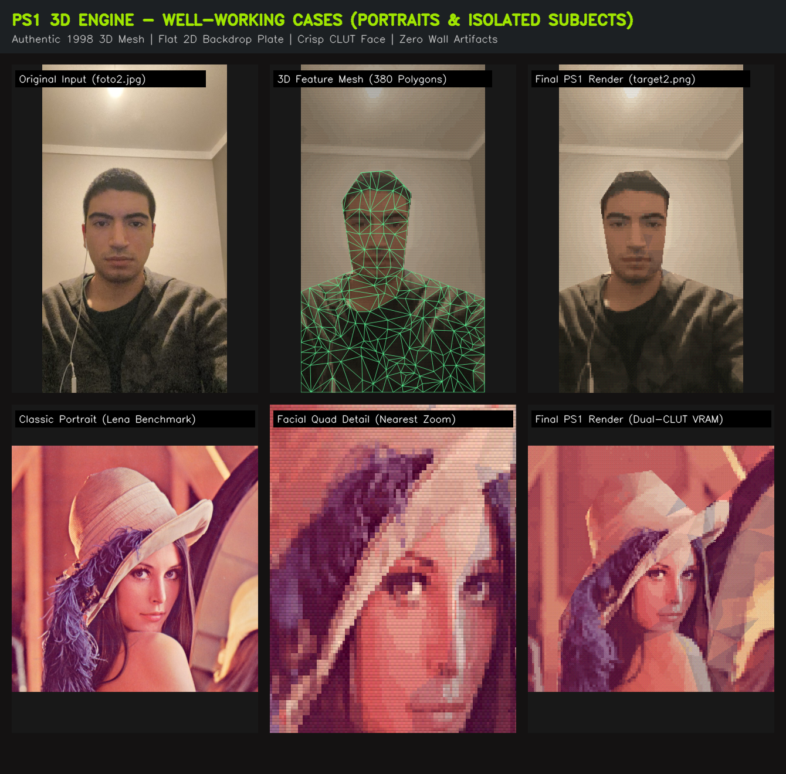
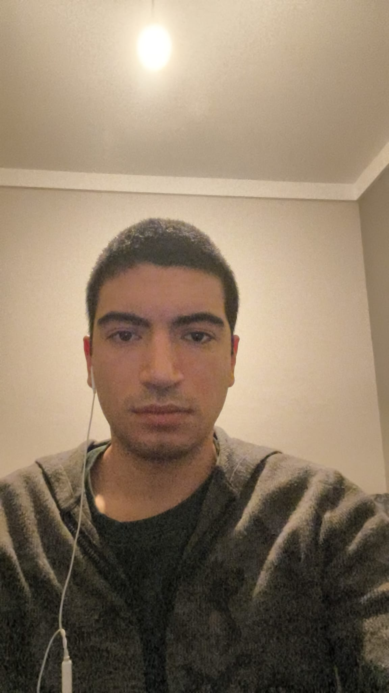
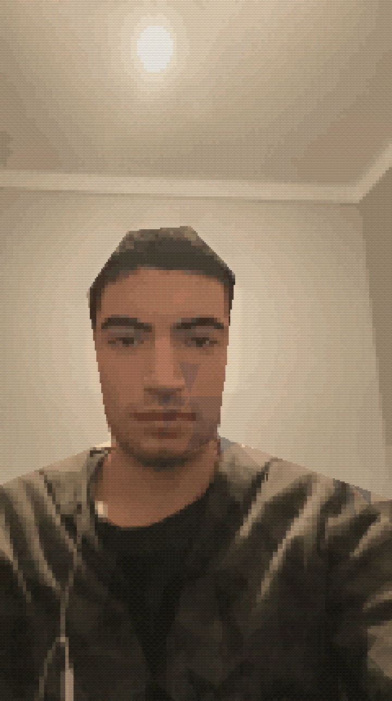
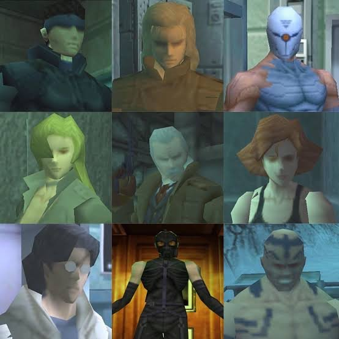
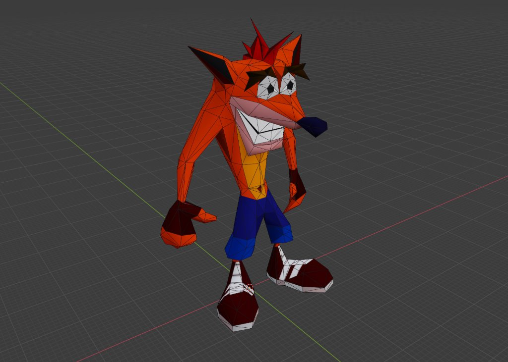
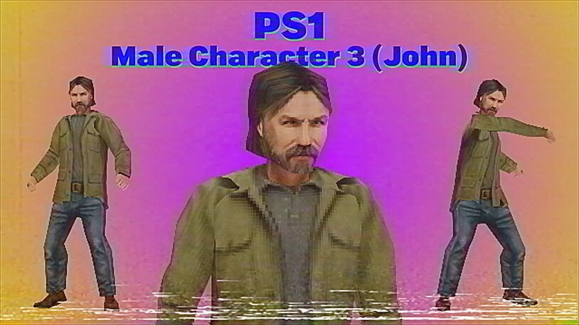
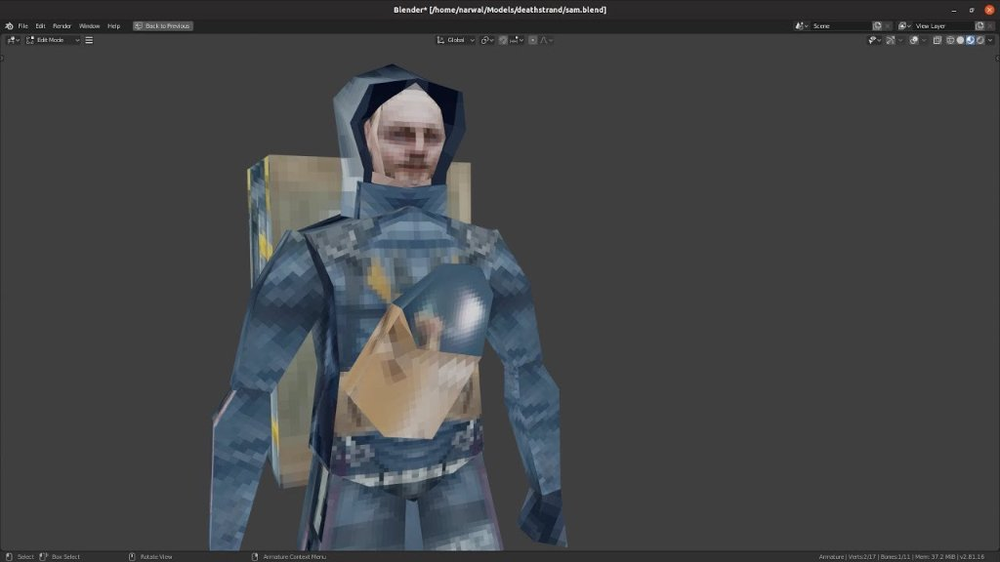
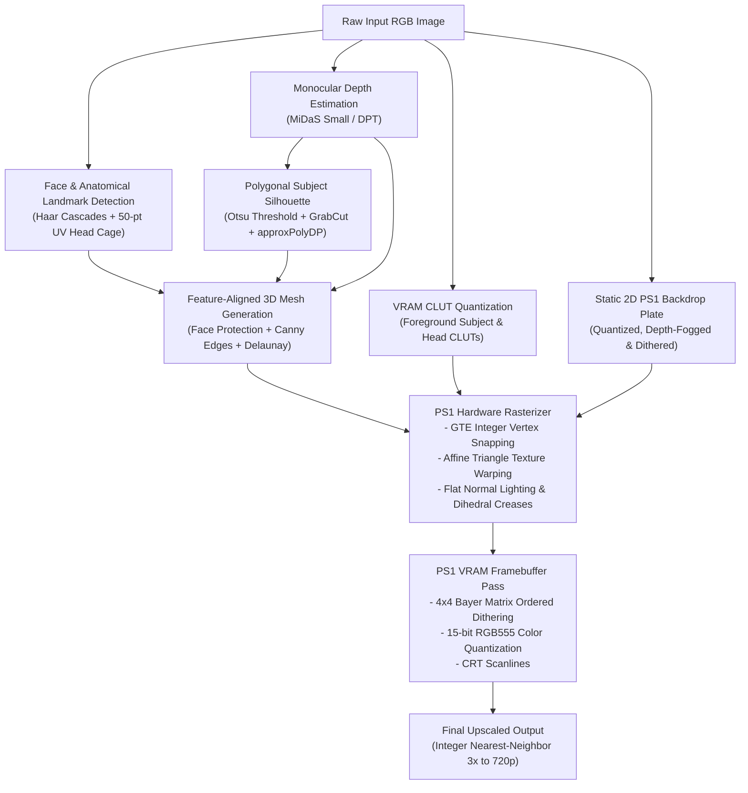
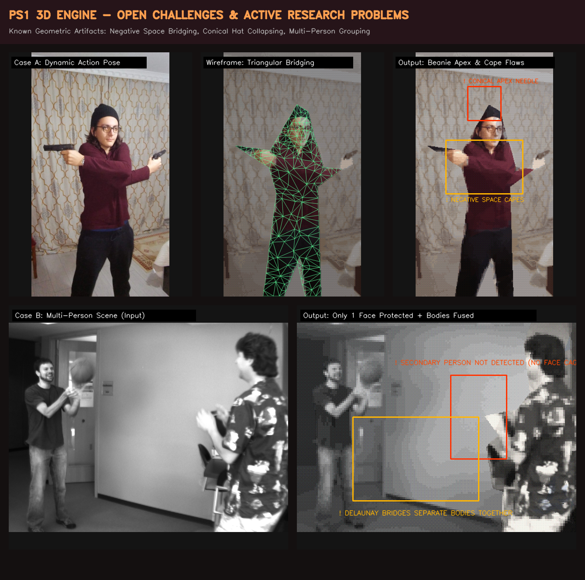

# 🎮 PS1 3D Reconstruction Engine (1998 Retro 32-Bit Aesthetics)

[](https://www.python.org/downloads/)
[](https://pytorch.org/)
[](https://opencv.org/)
[](https://gradio.app/)
[](https://opensource.org/licenses/MIT)

An authentic **PlayStation 1 (1998, 32-bit)** low-poly 3D reconstruction and hardware rendering engine.

Unlike simple post-processing pixelation filters or CRT scanline overlays, this engine performs **genuine 3D monocular depth estimation, feature-aligned Delaunay meshing, hardware-accurate affine texture warping (no perspective division), GTE integer coordinate vertex snapping, dual-CLUT color quantization, and 15-bit RGB555 ordered Bayer dithering**.

Inspired by the iconic visual style of late-90s classics:
- *Metal Gear Solid (1998)*
- *Silent Hill (1999)*
- *Resident Evil 2 (1998)*
- *Tomb Raider (1996–1999)*

---

## 📸 Showcase: Well-Working Scenarios (Portraits & Isolated Subjects)

Below are side-by-side comparisons demonstrating where the engine achieves its authentic 1998 PS1 vision: crisp facial landmarks, flat 2D backdrop plates (no background wall triangles), and chunky low-poly character meshes.



| Input Photo | Reconstructed PS1 3D Output (`2.png`) |
| :---: | :---: |
|  |  |

---

## 🎯 Target Aesthetic References (1998 Era)

The engine aims to match the authentic polygonal density, facet edge flow, and affine texture warping seen in 1998 PlayStation 1 character models:

| Metal Gear Solid (1998) | Crash Bandicoot Low-Poly Wireframe |
| :---: | :---: |
|  |  |
| *~350–500 triangles per model, distinct facial planes, cylindrical limb meshes* | *Economical low-poly topology with clean limb joints and mouth cavities* |

| Silent Hill / Retro Character | Modern Demake (PS1 Death Stranding) |
| :---: | :---: |
|  |  |
| *Blocky clothing folds, affine texture warping, 15-bit color palette* | *Chunky facet shading, detached limbs, and low-res VRAM texture mapping* |

---

## 🏛️ Pipeline Architecture



---

## ✨ Key Technical Innovations

### 1. Static 2D Pre-Rendered Backdrop vs. 3D Low-Poly Subject
Early PS1 games frequently composited fully 3D low-poly character models over static, pre-rendered 2D background plates (*Resident Evil*, *Final Fantasy VII/VIII*, *Fear Effect*).
- **Background Walls & Ceilings**: Isolated as a flat 2D backdrop plate quantized to `bg_clut_colors=16` with smooth atmospheric depth fog and Bayer dithering. Zero unwanted triangular facets or crease artifacts on flat walls or light fixtures.
- **Foreground Subject**: Confined strictly to a chunky 3D low-poly mesh (`350–450` triangles) with genuine 3D normal lighting and vertex wobble.

### 2. Anatomical PS1 Head Cage & Face Protection
Delaunay triangulation without anatomical constraints collapses faces into chaotic random triangles or washes out eyes and mouths:
- **50-Point Facial UV Cage**: Mathematically locks orbital eye quads, supra-brow ridge, infra-orbital cheek planes, nose ridge, upper/lower mouth boxes, and chin contour.
- **CLUT Texture Preservation**: Face triangles maintain `face_flatness <= 0.04`, preserving 95%+ of crisp pixelated CLUT texture (pupils, nostrils, lips, stubble) while clothing receives chunky flat facet shading (`facet_flatness = 0.48`).
- **Crease Attenuation**: Dihedral fold shadows are suppressed across the jaw and chin (`local_crease <= 0.03`), eliminating dark slash marks across beards and necks.

### 3. Hardware-Accurate Affine Texture Warping & GTE Vertex Snapping
- **Affine Texture Mapping**: The original PS1 GPU lacked perspective-correct texture division (`W`), causing textures to shear and distort diagonally across triangle splits. Our rasterizer computes 2D affine transformation matrices per triangle via `cv2.getAffineTransform` and `cv2.warpAffine` using `INTER_NEAREST`.
- **GTE Integer Grid Snapping**: Simulates the Geometry Transformation Engine (GTE) by rounding projected screen coordinates to discrete integer grid coordinates (`vertex_snap = 1.0`), producing the authentic retro vertex jitter.

### 4. 15-bit RGB555 Color Quantization & 4x4 Bayer Dithering
The PS1 VRAM framebuffer natively stores 15-bit color (5 bits Red, 5 bits Green, 5 bits Blue = 32,768 colors).
- Prior to bit-shifting, a spatial **4x4 Bayer Matrix** ordered dither pattern is applied to break up color banding across smooth lighting gradients.
- Scaled back to 8-bit standard RGB via bit expansion: `(c_5bit * 255) // 31`.

---

## 🚀 Quick Start

### 1. Installation

Clone this repository and install the dependencies:

```bash
git clone https://github.com/yavuzselimuyaner/ps1.git
cd ps1

pip install torch torchvision opencv-python numpy scipy gradio pillow
```

### 2. Interactive Web UI (Gradio)

Launch the visual browser interface:

```bash
python app.py
```
Open `http://localhost:7860` in your browser to adjust sliders (poly count, CLUT palette sizes, flatness, lighting, camera yaw) in real time with side-by-side comparisons and 3D wireframe views.

### 3. Command Line Interface (CLI)

Process any photo directly from your terminal:

```bash
# Basic run with the default authentic MGS1 preset
python ps1_3d_engine.py foto2.jpg -o output.png

# Custom settings: lower poly count, higher facet flatness, export 3D OBJ mesh
python ps1_3d_engine.py my_photo.jpg -o ps1_render.png --polys 350 --flatness 0.55 --obj character.obj
```

---

## ⚙️ Presets & Configuration Options

| Preset | Target Polygons | Texture Res | CLUT Colors | Facet Flatness | Lighting | Best For |
| :--- | :---: | :---: | :---: | :---: | :---: | :--- |
| **`mgs1`** *(Default)* | **420** | **92** | **22** | **0.48** | **0.56** | Authentic 1998 character busts & portraits (like `target2.png`) |
| **`balanced`** | 460 | 104 | 24 | 0.42 | 0.50 | General full-body & half-body action poses |
| **`ultra_lowpoly`** | 260 | 64 | 16 | 0.62 | 0.65 | Extreme retro / early-PS1 1996 aesthetic |

### CLI Arguments

| Argument | Type | Default | Description |
| :--- | :--- | :--- | :--- |
| `input_path` | `str` | *Required* | Path to input image (`.jpg`, `.png`, etc.) |
| `-o`, `--output` | `str` | `output_ps1.png` | Output path for rendered PS1 image |
| `--preset` | `str` | `mgs1` | Preset configuration (`mgs1`, `balanced`, `ultra_lowpoly`) |
| `--mode` | `str` | `isolated_subject` | `isolated_subject` (flat 2D backdrop + 3D subject) or `full_scene` |
| `--polys` | `int` | `420` | Target triangle polygon count |
| `--tex-res` | `int` | `92` | Body PS1 VRAM texture resolution |
| `--colors` | `int` | `22` | CLUT palette color count |
| `--flatness` | `float` | `0.48` | Body facet flatness blend (`0.0` = full texture, `1.0` = flat colors) |
| `--face-preserve` | `float` | `0.96` | Face preservation weight (`0.0..1.0`) |
| `--yaw` | `float` | `1.2` | 3D camera yaw angle in degrees |
| `--no-scanlines` | `flag` | `False` | Disable CRT scanline emulation pass |
| `--obj` | `str` | `None` | Export reconstructed 3D mesh as `.obj` |
| `--gui` | `flag` | `False` | Launch interactive Gradio Web UI |

---

## 📁 Repository Structure & Included Examples

```text
ps1/
├── ps1_3d_engine.py          # Core 3D reconstruction, triangulation & PS1 rasterizer
├── app.py                    # Interactive Gradio Web UI with real-time controls
├── PS1_ENGINE_STUDY_GUIDE.md # In-depth technical math & graphics guide
├── README.md                 # Project documentation & community roadmap
├── foto2.jpg                 # Default golden reference portrait photo
├── 2.png                     # Verified 1998 PS1 reference output (target2.png)
└── examples/                 # Curated sample images and target aesthetic references
    ├── sample_portrait.jpg       # Clean portrait input photo
    ├── sample_portrait_ps1.png   # Rendered PS1 portrait output
    ├── sample_action.jpg         # Full-body tactical action pose
    ├── sample_duo.jpg            # Two-character scene
    └── references/               # Target 1998 retro game graphics references
        ├── target_mgs1_roster.jpg
        ├── target_crash_wireframe.jpg
        ├── target_silent_hill_character.jpg
        └── target_death_stranding_ps1.jpg
```

---

## 🌟 Open Challenges & Community Roadmap (Help Wanted!)

We welcome open-source contributions from computer graphics, computer vision, and retro-gaming enthusiasts! Below is a visual summary of the active geometric artifacts and open challenges:



### 1. Negative Space Triangulation & Limbs Separation ("Wing/Cape" Prevention)
- **Problem**: When a subject poses with crossed arms, outstretched limbs, or hand props (e.g. pistols), Delaunay triangulation operates over the outer convex hull of the vertices and can bridge triangles across the empty negative space between the arms and torso.
- **Contribution Opportunity**: Implementing Constrained Delaunay Triangulation (CDT) or alpha-shape boundary clipping that strictly forbids triangle generation in regions where depth drops into a background valley (`depth < thresh`).

### 2. Multi-Character Segmentation & Group Shots
- **Problem**: In scenes with 2 or more people, Haar Cascade face detection and GrabCut foreground extraction need to handle multiple distinct topological clusters without connecting bridging polygons across empty space between the two characters.
- **Contribution Opportunity**: Multi-instance bounding-box clustering and per-character independent triangulation graphs.

### 3. Head & Hat Contour Reconstruction
- **Problem**: When characters wear hats, beanies, or tall hairstyles, naive polygon simplification (`approxPolyDP`) can collapse the rounded curved arch of the hat into a single apex point (cone / dunce cap).
- **Contribution Opportunity**: Adaptive crown-arch edge sampling that preserves broad 4–5 segment horizontal facet bands across the top of hats/hair regardless of silhouette bounding box scale.

### 4. Textured 3D Export (OBJ + MTL + VRAM Texture Atlas)
- **Problem**: Currently, the engine exports vertex coordinates and triangle indices to `.obj`.
- **Contribution Opportunity**: Generating normalized UV texture coordinates (`vt`) and exporting a companion `.mtl` and quantized `.png` texture page so the reconstructed models can be rendered in Blender, Unity, or Godot.

---

## 📚 In-Depth Learning Guide

If you want to study the mathematics and computer graphics principles used in this codebase line-by-line, check out our comprehensive guide:
- [`PS1_ENGINE_STUDY_GUIDE.md`](PS1_ENGINE_STUDY_GUIDE.md): Covers Monocular Depth Estimation, Affine Matrix Mathematics, CIELAB K-Means Clustering, Dihedral Angles, and GTE Hardware Constraints.

---

## 📄 License

This project is licensed under the MIT License. Contributions and PRs are welcome!
